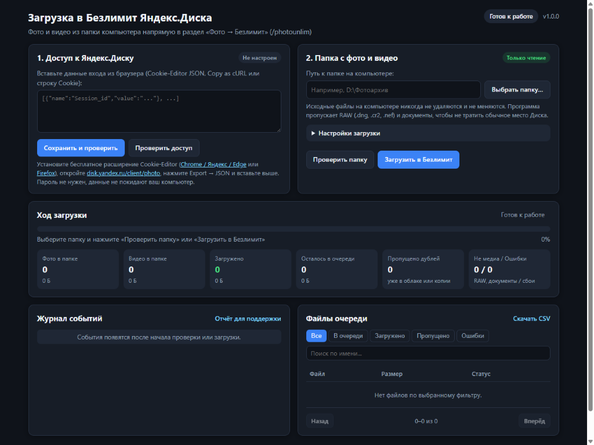

<div align="center">

# Загрузчик в Безлимит Яндекс.Диска (`/photounlim`)

**Бесплатная программа, которая загружает фото и видео из папки на компьютере<br>напрямую в безлимитное хранилище Яндекс.Диска (`/photounlim`).**

Без телефона, без Android-эмуляторов и без сторонних ключей API.<br>
Исходные файлы на компьютере не удаляются и не изменяются — программа работает строго в режиме чтения.

[](https://github.com/PXSYS13/yadisk_unlim_uploader/archive/refs/heads/main.zip)
[](https://github.com/PXSYS13/yadisk_unlim_uploader/issues/new/choose)
[](https://dalink.to/davronsvv)

[](https://github.com/PXSYS13/yadisk_unlim_uploader/releases/latest)
[](https://github.com/PXSYS13/yadisk_unlim_uploader/actions/workflows/ci.yml)

[](https://t.me/davronsv)


</div>

> [!IMPORTANT]
> **Открытое тестирование (`v1.0.0`).** Если вы нашли ошибку, странное поведение или сбой на конкретном формате фото/видео — нажмите в интерфейсе **«Отчёт для поддержки»** (в ZIP-архиве нет кук, паролей и ваших путей) и приложите архив в [GitHub Issues](https://github.com/PXSYS13/yadisk_unlim_uploader/issues/new/choose) или в комментариях в [Telegram-канале @davronsv](https://t.me/davronsv).

<p align="center">
  
</p>

## Что умеет

- **Прямая загрузка в `/photounlim` с компьютера** через внутренний web-API Яндекса (`models-v2`) по данным входа из браузера (`cookies.json`) — пароль от аккаунта не нужен.
- **Строго только чтение папки на ПК.** Исходные файлы никогда не удаляются, не перемещаются и не перезаписываются. Симлинки и NTFS-junction пропускаются.
- **Умный фильтр форматов.**
  - Фото: `JPG`, `JPEG`, `PNG`, `HEIC`, `HEIF`, `WebP`, `GIF`, `BMP`, `TIFF`.
  - Видео: `MP4`, `MOV`, `M4V`, `3GP`, `MKV`, `AVI`, `WebM`, `MTS`, `MPG`, `WMV`, `FLV`.
  - Документы, архивы и **RAW-файлы** (`.dng`, `.cr2`, `.cr3`, `.nef`, `.arw`, `.raw` и др.) пропускаются с отчётом — по правилам Яндекса RAW не входят в безлимит и расходуют обычное место Диска.
  - Проверка заголовков файлов (magic bytes) отсекает пустые и повреждённые файлы.
- **Тройная защита от дубликатов.**
  1. Локальная база (`upload_state.db`) и дедупликация копий внутри папки по `(size, md5)`.
  2. Предварительная сверка с уже загруженным в `/photounlim` (`mpfs/list`).
  3. Серверная дедупликация Яндекса (`hardlink` и HTTP 409 code 72).
- **Возобновляемая докачка больших видео.** Большие файлы отправляются частями (`Content-Range`) с автоматической дозагрузкой с места обрыва.
- **Сохранение хронологии.** Очередь сортируется по дате съёмки (`EXIF` для фото, `mvhd` для видео, дата из имени файла), а Яндекс сам раскладывает загруженное в ленту «Фото» по метаданным.
- **Защита основной квоты (Quota Guard).** Перед стартом проверяет активную подписку Яндекс 360 и лимит размера одного файла; в процессе контролирует `storage_type == "photounlim"` и останавливается, если начинает расходоваться обычное место Диска.
- **Режим наблюдения (`--watch` или галочка в интерфейсе).** Автоматически подхватывает и загружает новые фото и видео, которые появляются в папке.
- **Работает рядом с [Бэкапом Яндекс.Диска](https://github.com/PXSYS13/yadisk_backup).** Использует локальный порт `8001` (не пересекается с `8000`) и отдельную базу.

> [!NOTE]
> Чтобы загруженные в `/photounlim` фото и видео **не занимали обычное дисковое пространство**, на аккаунте должна быть активна подписка **Яндекс 360** с безлимитом для фото и видео. Если подписка не активна или истекла, программа предупредит об этом до старта и не начнёт загрузку без вашего явного подтверждения.

---

## Быстрый старт (веб-интерфейс)

Устанавливать Python вручную не нужно — лаунчер сам скачает проверенный по SHA-256 официальный `uv` и зависимости.

1. **Скачайте** [архив программы (ZIP)](https://github.com/PXSYS13/yadisk_unlim_uploader/archive/refs/heads/main.zip) и обязательно **распакуйте** его (в Windows: правой кнопкой по архиву → **«Извлечь всё»** — не запускайте файлы прямо из окна архива).
2. **Запустите программу:**
   - **Windows:** двойной клик по `webui.bat`. Если Windows покажет «Windows защитил ваш компьютер» — нажмите **«Подробнее» → «Выполнить в любом случае»**.
   - **macOS:** двойной клик по `webui.command` (если macOS предупредит о разработчике: *Системные настройки → Конфиденциальность и безопасность → «Всё равно открыть»*).
   - **Linux:** выполните `bash webui.sh` в папке программы.

   При первом запуске программа 1–2 минуты скачивает компоненты, затем откроет локальную страницу управления `http://127.0.0.1:8001`. Не закрывайте чёрное окно консоли, пока идёт загрузка.
3. **Добавьте данные входа из браузера (Шаг 1):**
   - Установите бесплатное расширение **Cookie-Editor**: [Chrome / Яндекс.Браузер / Edge / Opera](https://chromewebstore.google.com/detail/cookie-editor/hlkenndednhfkekhgcdicdfddnkalmdm) или [Firefox](https://addons.mozilla.org/ru/firefox/addon/cookie-editor/).
   - Откройте [disk.yandex.ru/client/photo](https://disk.yandex.ru/client/photo) (убедитесь, что вошли в нужный аккаунт).
   - Нажмите значок расширения 🍪 → **Export** → **Export as JSON**.
   - Вставьте скопированное в поле в программе и нажмите **«Сохранить и проверить»** (также поддерживаются `Copy as cURL`, `cookies.txt` Netscape и строка `Cookie:`).
4. **Выберите папку с фото и видео (Шаг 2)** — кнопка **«Выбрать папку…»** или путь вручную.
5. Нажмите **«Проверить папку»** (программа покажет количество фото, видео и пропущенных файлов без загрузки), затем **«Загрузить в Безлимит»**.

---

## Частые вопросы

<details>
<summary><b>Это безопасно? Программа отправляет куда-то мои файлы или куки?</b></summary>

Нет. Весь исходный код открыт под лицензией MIT:
- Пароль от Яндекса программе не нужен. Данные входа хранятся только локально в файле `cookies.json` (права `0600` на Linux/macOS) и общаются только с официальными серверами `disk.yandex.*` и `*.disk.yandex.net`.
- Сторонние куки других сайтов при импорте автоматически отбрасываются.
- Локальная страница `http://127.0.0.1:8001` доступна только с вашего компьютера и защищена проверкой `Host`/`Origin`/`Sec-Fetch-Site`, CSRF-токеном и строгой CSP.
- **Никогда не пересылайте `cookies.json` другим людям.** Для сообщений об ошибках пользуйтесь кнопкой **«Отчёт для поддержки»** — она вырезает все секреты, ссылки и имена пользователей.
</details>

<details>
<summary><b>Почему RAW-файлы (.dng, .cr2, .nef, .arw) пропускаются?</b></summary>

Яндекс.Диск не включает RAW-форматы в бесплатный безлимит и списывает их из основной квоты Диска. Чтобы случайно не забить ваш основной диск, программа пропускает RAW и показывает их во вкладке «Пропущено» и в CSV-отчёте.
</details>

<details>
<summary><b>Сохранятся ли мои подпапки внутри раздела «Фото → Безлимит»?</b></summary>

Раздел `/photounlim` у Яндекса плоский (без папок): все фото и видео отображаются в единой ленте «Фото» по дате съёмки. Программа рекурсивно забирает медиа из всех подпапок на ПК, автоматически разрешает совпадения имён (добавляя короткий суффикс хеша) и сохраняет хронологию по EXIF и метаданным видео.
</details>

<details>
<summary><b>Можно ли остановить загрузку и продолжить завтра?</b></summary>

Да. Прогресс хранится в `upload_state.db`. При следующем запуске уже загруженные файлы и дубликаты повторно не отправляются, а оборванные большие видео докачиваются по частям.
</details>

<details>
<summary><b>Что делать при ошибках, 429, SmartCaptcha или проблемах с запуском?</b></summary>

| Ситуация | Что происходит и что делать |
|---|---|
| Ошибки `429` или `SmartCaptcha` | Яндекс ограничил частоту запросов. Программа сама ставит паузу и продолжает загрузку без потери прогресса. При частых паузах снизьте потоки в настройках до `1`. |
| «Данные входа истекли» | Cookies в браузере устарели. Повторите экспорт из Cookie-Editor на `disk.yandex.ru/client/photo` и сохраните заново. |
| «Нет активной подписки Яндекс 360» | Quota Guard остановил загрузку, чтобы не потратить обычное место Диска. Продлите подписку или подтвердите галочкой осознанную загрузку в счёт квоты. |
| Ошибка `uv` при запуске на системе со старым глобальным `uv` | Выполните `uv self update` или удалите старый `uv` из `PATH` — лаунчер сам скачает совместимый `uv 0.13.4` в локальную папку `.uv`. |
| Другая ошибка или сбой | Нажмите **«Отчёт для поддержки»** в программе и приложите скачанный ZIP-файл к [issue на GitHub](https://github.com/PXSYS13/yadisk_unlim_uploader/issues/new/choose) или в [@davronsv](https://t.me/davronsv). |
</details>

---

## Консольный режим (CLI)

<details>
<summary><b>Команды для терминала и автоматизации</b></summary>

```powershell
# Предварительная проверка папки без загрузки
uv run upload_unlim.py scan --source "D:\Фотоархив"

# Загрузка всех фото и видео в /photounlim (с докачкой при повторном запуске)
uv run upload_unlim.py run --source "D:\Фотоархив"

# Фоновое наблюдение за папкой (проверка каждые 60 секунд)
uv run upload_unlim.py run --source "D:\Фотоархив" --watch --watch-interval 60

# Статус очереди, повтор ошибок и очистка локальной очереди
uv run upload_unlim.py status
uv run upload_unlim.py retry-failed
uv run upload_unlim.py reset

# Диагностический зонд (1 тестовое фото + 1 видео с автоудалением из /photounlim и корзины)
uv run upload_unlim.py probe
```

</details>

---

## Другие программы автора

- **[Бэкап Яндекс.Диска (`yadisk_backup`)](https://github.com/PXSYS13/yadisk_backup)** — обратная задача: сохраняет весь Яндекс.Диск, безлимит фото и публичные папки на ваш компьютер.
- **[Бэкап iCloud Фото (`icloud_backup`)](https://github.com/PXSYS13/icloud_backup)** — выгрузка медиатеки iCloud Фото на компьютер.
- **[Бэкап ВКонтакте (`vk_backup`)](https://github.com/PXSYS13/vk_backup)** — локальный просмотр и сохранение архива страницы ВК.

## Поддержать проект

Программа бесплатная и с открытым кодом (лицензия MIT). Если она сэкономила вам время и помогла перенести фотоархив — поддержать разработку можно здесь:

<p align="center">
  <a href="https://dalink.to/davronsvv"></a>
</p>
